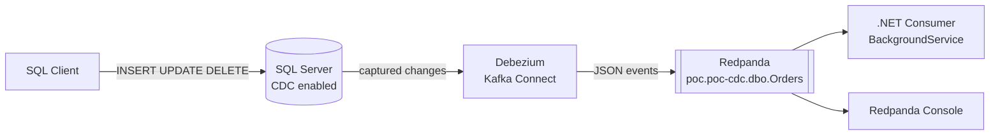
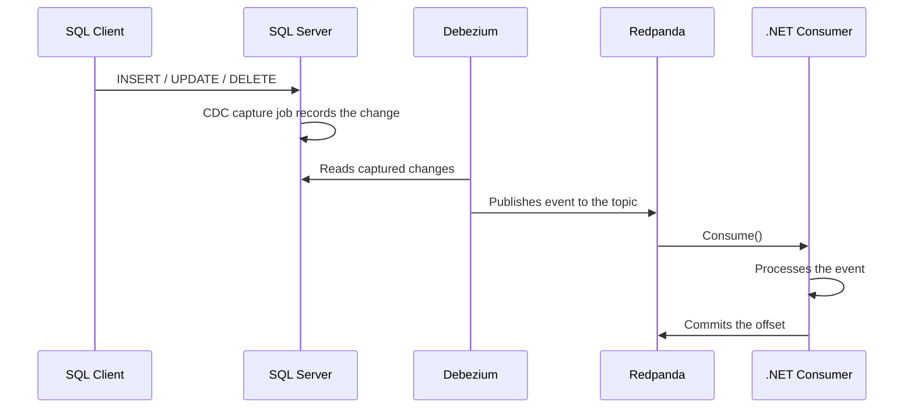
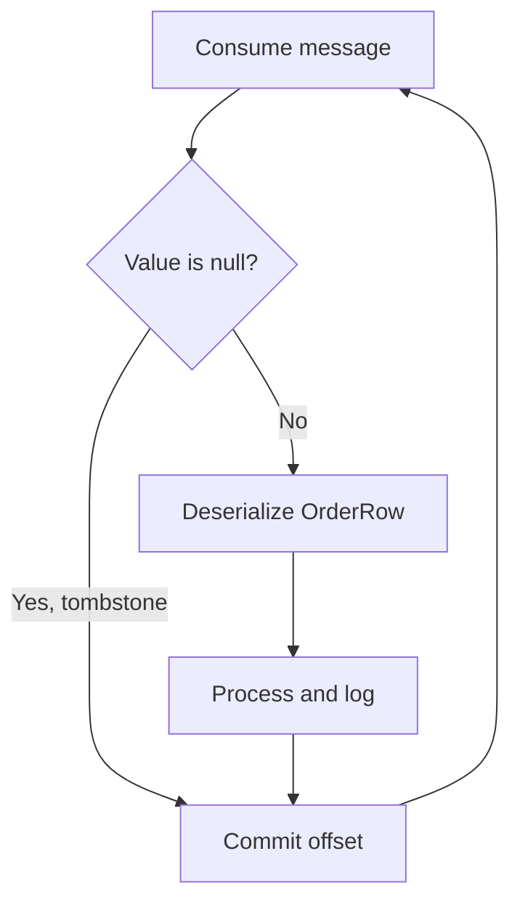

# CDC PoC: SQL Server → Debezium → Redpanda → .NET

Proof of concept for **Change Data Capture (CDC)**: every `INSERT`, `UPDATE`, and `DELETE` on a SQL Server table is published as an event to Redpanda (Kafka-compatible) and consumed by a .NET application.

## Architecture



## Change flow



## Consumer logic



## Stack

| Component | Technology |
|---|---|
| Database | SQL Server 2022 (Docker) |
| Change capture | Debezium (Kafka Connect) |
| Broker | Redpanda |
| Exploration | Redpanda Console |
| Consumer | .NET Worker Service + Confluent.Kafka |

## Structure

```text
cdc-poc/
├── docker-compose.yml
├── connector.json
├── CdcConsumer/
│   ├── Program.cs
│   ├── OrdersCdcConsumer.cs
│   ├── KafkaOptions.cs
│   ├── CdcJsonContext.cs
│   └── appsettings.json
└── README.md
```

## Requirements

- Docker Desktop
- .NET SDK
- A SQL client (DBeaver, Azure Data Studio, etc.)
- On Apple Silicon Macs: enable *Use Rosetta for x86_64/amd64 emulation* in Docker Desktop

## How to run

### 1. Start the infrastructure

```bash
docker compose up -d
docker compose ps
```

### 2. Create the database and enable CDC

```sql
CREATE DATABASE poc-cdc;
GO
USE poc-cdc;
GO
CREATE TABLE dbo.Orders (
    Id INT IDENTITY PRIMARY KEY,
    Customer NVARCHAR(100),
    Total DECIMAL(10,2)
);
GO
EXEC sys.sp_cdc_enable_db;
GO
EXEC sys.sp_cdc_enable_table
    @source_schema = 'dbo',
    @source_name   = 'Orders',
    @role_name     = NULL;
GO
```

### 3. Register the connector

Set `database.password` in `connector.json` to the password configured in your `docker-compose.yml` (`<SA_PASSWORD>`):

```bash
curl -X POST -H "Content-Type: application/json" \
  --data @connector.json \
  http://localhost:8083/connectors

curl http://localhost:8083/connectors/sqlserver-orders/status
```

Both the connector and its task should be `RUNNING`.

### 4. Run the consumer

```bash
cd CdcConsumer
dotnet run
```

### 5. Try it out

```sql
INSERT INTO dbo.Orders (Customer, Total) VALUES ('Ana', 100);
UPDATE dbo.Orders SET Total = 150 WHERE Customer = 'Ana';
DELETE FROM dbo.Orders WHERE Customer = 'Ana';
```

Events show up in the consumer log and in Redpanda Console: <http://localhost:8080>.

## Configuration (`appsettings.json`)

```json
{
  "Kafka": {
    "BootstrapServers": "localhost:19092",
    "GroupId": "orders-poc",
    "Topic": "poc.poc-cdc.dbo.Orders"
  }
}
```

Read through the *Options Pattern* and validated at startup (`ValidateOnStart`).

## Message format

The connector uses the `ExtractNewRecordState` SMT, which flattens the event:

```json
{
  "Id": 1,
  "Customer": "Ana",
  "Total": "100.00",
  "__op": "c",
  "__deleted": "false"
}
```

| `__op` | Meaning |
|---|---|
| `r` | Initial snapshot read |
| `c` | Create (INSERT) |
| `u` | Update (UPDATE) |
| `d` | Delete (DELETE), arrives with `__deleted = "true"` |

`DECIMAL` values arrive as strings (`decimal.handling.mode=string`) to avoid base64 encoding.

## Technical decisions

- **Manual offset commits** after processing: guarantees *at-least-once* delivery.
- **Source generators** for JSON (`JsonSerializerContext`) and logging (`[LoggerMessage]`): no runtime reflection.
- **Graceful shutdown**: the Generic Host cancels the `CancellationToken` on SIGTERM/Ctrl+C and the consumer exits cleanly with `Close()`.

## Considerations

- Being *at-least-once*, an event may be delivered more than once: processing must be **idempotent**.
- After a `DELETE`, Debezium usually emits a message with a `null` value (*tombstone*); the consumer ignores it.
- This is a PoC: no persistent volumes, TLS, or secrets management.

## Cleanup

```bash
docker compose down
```